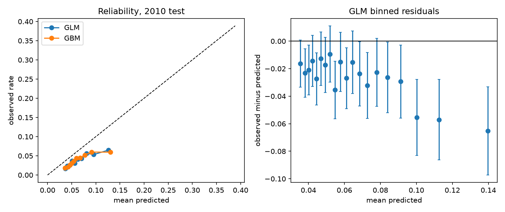

# 30-day hospital readmissions on CMS synthetic Medicare claims

Which discharges are most likely to come back within 30 days, and which hospitals readmit more than their case mix predicts? This repo builds a HEDIS PCR-style readmission measure and a calibrated risk model from CMS DE-SynPUF claims, in SQL Server and Python, with every count reconciled between the two.

> **Data caveat (CMS):** DE-SynPUF is synthetic and has "very limited inferential research value." The numbers below show the method working; they are not findings about Medicare patients or real hospitals.

## Results (Sample 1, test year 2010)

| | Baseline GLM (age, prior stays) | Logistic GLM | Gradient boosting |
|---|---|---|---|
| ROC AUC | 0.552 | 0.612 | 0.611 |
| Brier | 0.0384 | 0.0384 | 0.0385 |
| ECE (10 bins) | 0.027 | 0.027 | 0.026 |
| Calibration intercept / slope | -0.55 / 0.97 | -0.56 / 0.93 | -0.54 / 0.85 |
| Top-decile capture of readmissions | 14.1% | 16.5% | 15.2% |

- **Protocol:** forward-chaining. Trained on 17,857 index stays discharged in 2009, tested on 9,385 discharged Jan 1 to Dec 1, 2010 (8,260 beneficiaries).
- **Significance:** paired cluster bootstrap over beneficiaries, 500 draws.
  - GBM minus GLM: delta AUC -0.000 (95% CI -0.019 to 0.016). **No evidence boosting helps; the GLM is kept.**
  - GLM minus baseline: delta AUC 0.060 (95% CI 0.032 to 0.086). The full model does add ranking signal.
- **Calibration fails on the test year.** The model predicts 6.7% readmitted; 3.9% were. The 2009 training rate was 7.3%. CMS documents lower 2010 claim counts from attrition and disclosure treatment, so the gap most likely reflects drift in the data, not a ranking failure. **Recalibrate the intercept before using predicted counts for staffing.**
- **Targeting value is modest:** the top 10% of stays by GLM risk hold 16.5% of readmissions, against 10% at random.
- **Hospitals:** 57 hospitals had 25+ test-year index stays; none differ from expected at 95%. That is the expected result on synthetic provider IDs.
- **What would have falsified this:** a GBM-minus-GLM CI above 0 (boosting wins), a GLM-minus-baseline CI covering 0 (the model adds nothing), or a calibration intercept near 0 on the test year (no drift).



## Run it

```powershell
uv sync
uv run pytest                                   # synthetic sample, end to end, no downloads
uv run python scripts/download_synpuf.py        # CMS Sample 1 into data/raw (about 60 MB unzipped)
uv run python -m claims.run                     # cohort, models, measure, outputs/
uv run python scripts/load_sqlserver.py         # SQL Server mart + reconciliation (LocalDB by default)
```

`load_sqlserver.py` uses LocalDB by default. For another server, set `CLAIMS_SQL_CONN` to an ODBC connection string. The script exits 1 if SQL and pandas disagree on stays, index stays, readmissions, or prior-stay sums.

## Layout

```
sql/01_schema.sql          raw and mart tables with constraints
sql/02_build_mart.sql      gaps-and-islands transfer merge, index stays, attrition
sql/03_quality_measure.sql monthly and hospital O/E views for Power BI
src/claims/cohort.py       same cohort rules in pandas
src/claims/model.py        GLM, GBM, calibration metrics, cluster bootstrap
src/claims/measure.py      O/E with exact Poisson intervals
src/claims/run.py          end-to-end run writing outputs/
src/claims/sample.py       synthetic sample in the SynPUF layout (used by tests)
docs/                      spec, data dictionary, manager memo template, reproducibility checklist
```

## Measure definition (short)

PCR-style, adapted; **not a certified HEDIS rate**. Direct transfers (next admission no more than 1 day after discharge) are one stay. Index stays: alive at discharge, 12 months of Part A and no HMO months in the prior year. Readmission: any admission 2 to 30 days after discharge. Not implemented: the planned-readmission exclusion and the outlier-member rule. Full table in [docs/spec.md](docs/spec.md).

## Leakage controls

Features come from the prior calendar year's beneficiary file and from claims before the index admission (`tests/test_cohort.py` pins this). Test discharges stop at Dec 1, 2010, so every outcome window is observed.

## Authorship

Built with AI coding assistance (Claude Code). I set the scope and questions and reviewed the methods, code and results.
